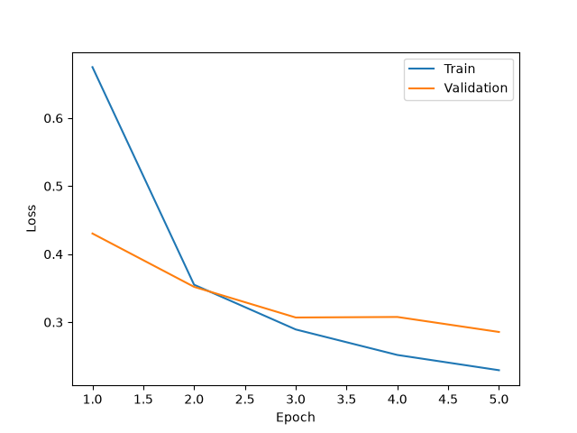
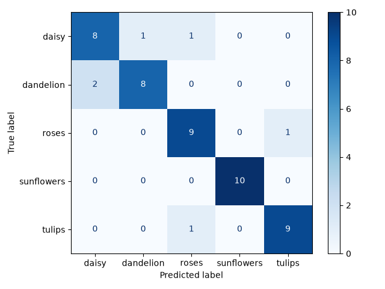

# Создание простой системы классификации изображений на основе сверточных нейронных сетей.

[Текст задания](./docs/task.md)

## Теоретическая база

Классификация изображений --- определение принадлежности изображения к одному из заранее заданных классов.

CNN в общем случае устроена так:
- на вход подаётся изображение в виде многомерного массива чисел (тензора)
- сверточные слои имеют множество фильтров (матриц свертки); веса фильтров изменяются (обучаются)
- слои формируют наборы карт признаков (тензоры)
- первые слои выделяют простые элементы (границы, линии, углы)
- более глубокие слои учитывают простые признаки в составе более сложных структур (частей объектов, текстур)
- между свертками могут применяться функции активации (ReLU), нормализация (BatchNorm) и уменьшение пространственного разрешения (Pooling)
- полученные признаки передаются классификатору, который вычисляет оценки принадлежности изображения к классам

### Метрики

- TP (True Positive) --- правильно отнесли изображение к классу.
- FP (False Positive) --- ошибочно отнесли изображение к классу.
- FN (False Negative) --- не распознали изображение нужного класса.
- TN (True Negative) --- правильно определили, что изображение не принадлежит классу.

| Метрика   |                             Формула                             | Назначение                                                                 |
|-----------|:---------------------------------------------------------------:|----------------------------------------------------------------------------|
| Precision |                       $\frac{TP}{TP+FP}$                        | Какая доля изображений, отнесённых к классу, действительно ему принадлежит |
| Recall    |                       $\frac{TP}{TP+FN}$                        | Какую долю изображений класса модель смогла обнаружить                     |
| F1-score  |                        $\frac{2PR}{P+R}$                        | Гармоническое среднее Precision и Recall                                   |
| Accuracy  | $\frac{\text{Правильные предсказания}}{\text{Все изображения}}$ | Общая доля правильных классификаций                                        |

## Описание разработанной системы (алгоритмы, принципы работы, архитектура, системные требования)

Зависимости системы:

| Имя          | Версия |
|--------------|--------|
| matplotlib   | 3.11.2 |
| requests     | 2.34.2 |
| torch        | 2.14.1 |
| torchvision  | 0.29.1 |
| scikit-learn |        |

Датасет был загружен и разделен в пропорции 80/20 на train и val программно.
Тестовый датасет из 50 изображений был собран и размечен вручную.

В системе используется предобученная на ImageNet-1K свёрточная сеть ResNet18. 
Параметры предобученных слоёв были заморожены, а последний полносвязный слой заменён на новый с пятью выходами. 
Обучение выполнялось с использованием CrossEntropyLoss и оптимизатора Adam с learning rate 0.001.

Обучение проводилось на CPU в 5 эпох с 16 изображениями за шаг.
В процессе обучения веса модели сохранялись при достижении нового минимума val_loss.

## Результаты работы и тестирования системы (скриншоты, изображения, графики, закономерности)

Для контроля переобучения модели на каждой эпохе вычислялись train и val loss.
График представлен ниже.



На тестовой выборке модель правильно классифицировала 44 из 50 изображений (88%). 
Наилучший результат получен для подсолнухов: Precision, Recall и F1-score составили 1.0. 
Для ромашек показатели ниже --- по 0.8.

```
data/test\daisy\daisy-01.jpg: Actual=daisy, Predicted=daisy, Confidence=98.9%
data/test\daisy\daisy-02.jpg: Actual=daisy, Predicted=roses, Confidence=73.7%
...
data/test\tulips\tulips-08.jpg: Actual=tulips, Predicted=tulips, Confidence=81.4%
data/test\tulips\tulips-09.jpg: Actual=tulips, Predicted=roses, Confidence=65.5%
data/test\tulips\tulips-10.jpg: Actual=tulips, Predicted=tulips, Confidence=92.3%

Test accuracy: 88.00%
Correct: 44/50

Classification report:
              precision    recall  f1-score   support

       daisy       0.80      0.80      0.80        10
   dandelion       0.89      0.80      0.84        10
       roses       0.82      0.90      0.86        10
  sunflowers       1.00      1.00      1.00        10
      tulips       0.90      0.90      0.90        10

    accuracy                           0.88        50
   macro avg       0.88      0.88      0.88        50
weighted avg       0.88      0.88      0.88        50
```

Матрица ошибок визуализирует распределение предсказаний по классам.
Например, модель в двух случаях ошибочно распознала ромашки, как одуванчики и розы, но во всех случаях для подсолнухов правильно определила класс.



## Выводы по работе
## Использованные источники

- https://www.tensorflow.org/tutorials/load_data/images?hl=ru
- https://docs.pytorch.org/tutorials/beginner/transfer_learning_tutorial.html#convnet-as-fixed-feature-extractor
- https://docs.pytorch.org/vision/main/models/generated/torchvision.models.resnet18.html
- https://scikit-learn.org/stable/modules/model_evaluation.html#string-name-scorers

